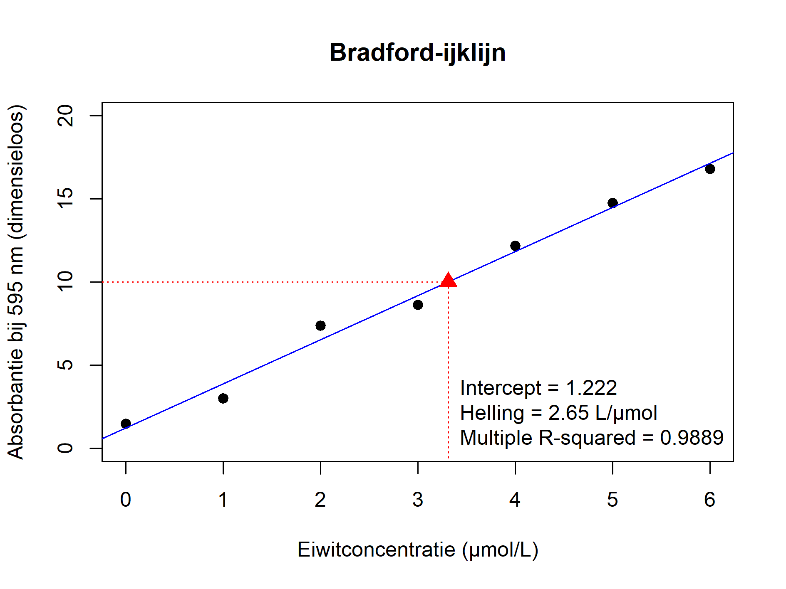

## Wat is het model?

Het statistische model bij jullie experiment is:

$$\text{Abs} = a + b \cdot \text{Conc} + \varepsilon$$

We nemen aan dat $\varepsilon$ normaal verdeeld is met gemiddelde 0 en standaarddeviatie (SD) 1.

Met `set.seed()` krijg je bij elke run dezelfde toevalsgetallen:

```{r}
set.seed(222)
```

Eerst maken we de concentraties `Conc`:

```{r}
Conc <- c(0, 1, 2, 3, 4, 5, 6)
n <- length(Conc)
```

Dan kiezen we het intercept `a` en de richtingscoëfficiënt `b`:

```{r}
a <- 0
b <- 3
```

Dan maken we eerst het deterministische model en plotten we dat:

```{r}
Abs <- a + b * Conc
plot(Abs ~ Conc)
abline(a, b)
```

Alle punten liggen op de lijn. Nu voegen we spreiding toe aan de data. Daarvoor maken we eerst $\varepsilon$:

```{r}
Epsilon <- rnorm(n = n, mean = 0, sd = 1)
print(Epsilon)
```

### Interlude: variantie

De spreiding van `Epsilon` meten we met de variantie: de som van de kwadraten rond het gemiddelde, gedeeld door $n - 1$:

$$s^2 = \frac{\sum_{i=1}^{n} (\varepsilon_i - \bar{\varepsilon})^2}{n - 1}$$

In R wordt dat:

```{r}
sum((Epsilon - mean(Epsilon))^2)
Variantie <- sum((Epsilon - mean(Epsilon))^2) / (n - 1)
Variantie
var(Epsilon)
sqrt(var(Epsilon))
sd(Epsilon)
```

Nu simuleren we het hele model:

```{r}
Abs <- a + b * Conc + Epsilon
plot(Abs ~ Conc, ylim =c(0,20))
abline(a, b, lty = 2)
abline(lm(Abs ~ Conc), lty = 1)
```

De gestippelde lijn is de echte lijn, de doorgetrokken lijn de geschatte. Nu kunnen we er een statistische analyse op loslaten:

```{r}
Model <- lm(Abs ~ Conc)
summary(Model)
```

Wat zit er in `Model`?

```{r}
str(Model)
```

Als je er elementen uit wilt halen:

```{r}
Model$coefficients    # of coef(Model)
Model$residuals       # of resid(Model)
Model$fitted.values   # of fitted(Model)
```

Let op: de residuen zijn niet hetzelfde als `Epsilon`. `Epsilon` is het echte stochastische deel; de residuen zijn de afstanden tot de *geschatte* lijn.

Zo ook voor de samenvatting van een model:

```{r}
str(summary(Model))
summary(Model)$r.squared
```

## Figuur voor je verslag

Tot slot maken we een nette figuur van de ijklijn die je kunt opslaan en in Word kunt invoegen. Eerst schatten we de concentratie van een onbekend monster uit de gemeten absorbantie. Vul hier je eigen gemeten absorbantie in:

```{r}
Abs_onbekend <- 10
a_hat <- coef(Model)[1]
b_hat <- coef(Model)[2]

Conc_onbekend <- (Abs_onbekend - a_hat) / b_hat
Conc_onbekend
```

Nu tekenen we de figuur en slaan we die meteen op als png-bestand. Met `png()` open je het bestand, daarna teken je de figuur, en met `dev.off()` sluit je het bestand weer af:

```{r}
R2 <- summary(Model)$r.squared

## Probeer de code te lezen, het zou mogelijk moeten zij alles te duiden.

png("ijklijn.png", width = 16, height = 12, units = "cm", res = 300)


plot(Abs ~ Conc, pch = 19, ylim = c(0,20),
     xlab = "Eiwitconcentratie (\u00b5mol/L)",
     ylab = "Absorbantie bij 595 nm (dimensieloos)",
     main = "Bradford-ijklijn")
abline(Model, col = "blue")                                            # regressielijn
segments(par("usr")[1], Abs_onbekend, Conc_onbekend, Abs_onbekend,
         lty = 3, col = "red")                                         # van y-as naar het punt
segments(Conc_onbekend, Abs_onbekend, Conc_onbekend, par("usr")[3],
         lty = 3, col = "red")                                         # van het punt naar x-as
points(Conc_onbekend, Abs_onbekend, pch = 17, col = "red", cex = 1.5)  # onbekend monster
legend("bottomright", bty = "n",
       legend = c(paste("Intercept =", round(a_hat, 3)),
                  paste("Helling =", round(b_hat, 3), "L/\u00b5mol"),
                  paste("Multiple R-squared =", round(R2, 4))))

dev.off()   # deze moet je niet vergeten anders wordt de png file niet gemaakt
```



Het bestand `ijklijn.png` staat nu in je werkmap (die vind je met `getwd()`). In Word voeg je het in via *Invoegen* → *Afbeeldingen*.
